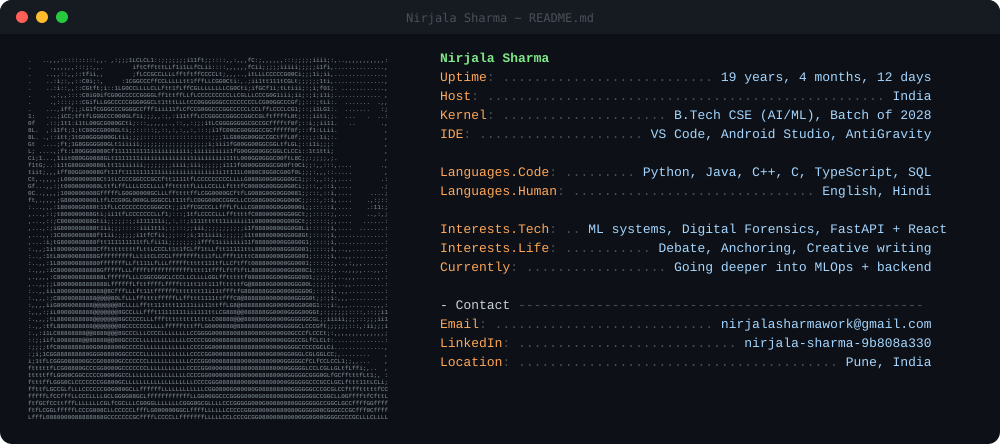

<!-- ═══════════ HEADER ═══════════ -->


<div align="center">

<a href="https://git.io/typing-svg">
  
</a>

</div>

<!-- ═══════════ NEOFETCH CARD ═══════════ -->
<div align="center">
  <picture>
    <source media="(prefers-color-scheme: dark)" srcset="dark_mode.svg">
    <source media="(prefers-color-scheme: light)" srcset="light_mode.svg">
    
  </picture>
</div>

---

## 👋 whoami

I'm Nirjala, a B.Tech CSE (AI/ML) student in Pune. I like the moment an ML model stops being a notebook and becomes something a real person uses. Outside code, I'm the one holding the mic: debating, anchoring events, writing stuff that isn't code.

```bash
$ cat about.txt
name        : Nirjala Sharma
from        : Pune, India
studying    : B.Tech CSE (AI/ML) @ Pimpri Chinchwad University (2028)
likes       : ML systems, digital forensics, debate, anchoring
vibe        : TODO (one honest line about how you work with people)
```

## 🎯 Right now

- 🔭 Going deeper: ML systems, MLOps, backend engineering
- 🎤 On stage: anchoring and debate whenever there's a mic
- 🏆 Hackathon mode: always looking for the next team
- 📚 Reading / watching: TODO
- 🎧 On repeat: TODO

## 🎲 Random facts

- Top 4 finalist in an inter-college debate, 2nd in a group discussion
- Co-presented research at the International Master Mind Meet, PCU
- TODO: your most useless skill
- TODO: unpopular opinion (tabs vs spaces, etc.)

## 🧰 Tools I reach for

<div align="center">


</div>

## 📊 GitHub Stats

<div align="center">


<br/>


</div>

### 🐍 Snake

<div align="center">
  <picture>
    <source media="(prefers-color-scheme: dark)" srcset="https://raw.githubusercontent.com/readytolearn-hub/readytolearn-hub/output/github-snake-dark.svg" />
    <source media="(prefers-color-scheme: light)" srcset="https://raw.githubusercontent.com/readytolearn-hub/readytolearn-hub/output/github-snake.svg" />
    
  </picture>
</div>

## 🤝 Say hi

<div align="center">

[](https://www.linkedin.com/in/nirjala-sharma-9b808a330)
[](mailto:nirjala.sharma24@pcu.edu.in)

<br/>

*Open to internships, hackathon teams and research collaborations.*

</div>


